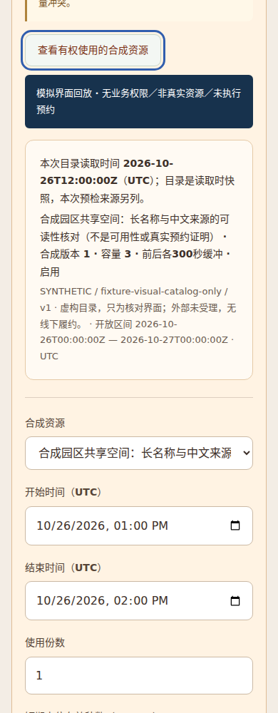
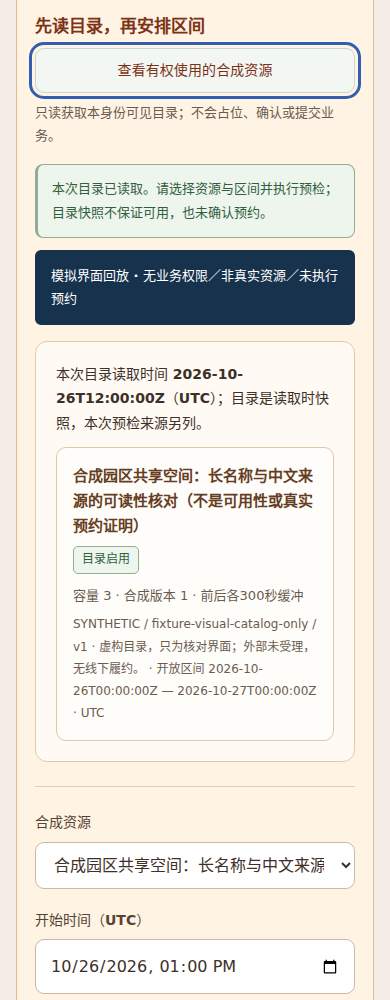

# Resource catalog presentation: run48 limited PASS

[Official run](https://github.com/T1doo/ParkWeave/actions/runs/40370377840), job `121739192786`, artifact `12673021051` (`fictional-park-browser-48`). One new hosted Linux Chrome attempt, normal sandbox; not a rerun of47.

- Executed source: `c8d01a956c1d81dc9112c9ae3610139a5cbdbc39`.
- Before product: `dc0df5aa40f3a8e400da7dfc9fb3ab01eb725406`, page SHA256 `81939da2c779849e6e4785e28d283f6519afd554f94f475376b286e45c20cc37`.
- After product: `f6d9077ecae7166fde43b1a39a50c34a9509c5b3`, page SHA256 `c52acb4262a6f530ea97f9f0e5c29c16688622c68a7e3e798ec96622202fbee3`.
- Original ZIP:947551 bytes, SHA256 `a660b2846f992fb3f91b7b065409faf4978ea0924b5c7d1db51c3e72f46ce558`, matching the official digest. It contains eight original PNGs and `result.json`, within the existing10-file/8MiB bound.
- Full decoded official API job log:328626 UTF-8 bytes including BOM, SHA256 `fe4e620490b9d9c395145c3d71b2037cefcf70a0c4916d69d75888a5ebcdca82`. No summary-upload-aborted message; summary body was not separately read. Stdout PENDING_FINALIZATION is not the terminal outcome. Final result PASS and job success/worker0 establish this limited terminal result.

All eight raw PNGs were actually viewed at original size and independently reviewed. READY pairs cover1200/390; supplementary frames cover after1200 LOADING/EMPTY and after390 ERROR/DENIED. The390 title uses its full row with the badge separate, source/time text remains readable, tested regions stay in the viewport, and the recorded focus roundtrips are visible. Eight original-PNG marker background/white-glyph counts were independently recalculated and match the report. The detached canvas only reads screenshots; it does not redraw public PNGs. Pixel counts are not full-text OCR or whole-page accessibility certification.

Server and browser each observed25 GETs, not50 combined requests. Four `/api/run-access/status` responses are explicitly simulated all-disabled projections. The500 and403 are deliberate simulated failure/refusal states. POST0; no page errors, route violations or unexpected server GETs. There is no product API factory, PG, real authority, reservation, model, Windows or user-device action. The dark simulated-view labels are test annotations, not product branding. See the original [run47 FAIL](../run47/README.md), which remains FAIL because its route plan omitted four GETs; the prior label-absence claim is explicitly corrected there.

Cleanup: browser CLOSED, listener REFUSED, owned tree CLEANUP_CONFIRMED, worker0, bound processes exited, no remaining children/private-session members and no cleanup errors.18.325 seconds measures work plus cleanup, not cleanup alone. Private-directory deletion was not verified. This evidence does not extend to real API/business permissions, complete resource workflows, full WCAG, touch devices or global frontend acceptance.

Two convenient PNG copies below are byte-identical to the corresponding ZIP members:

