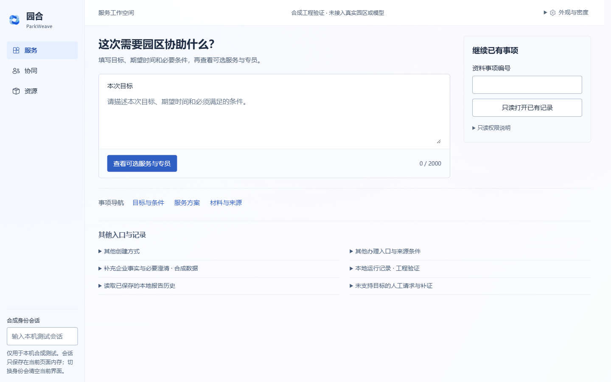
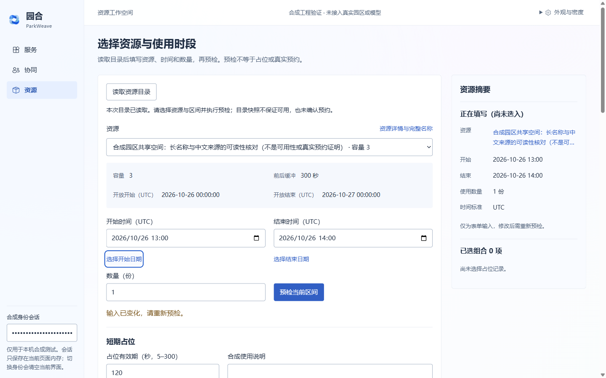
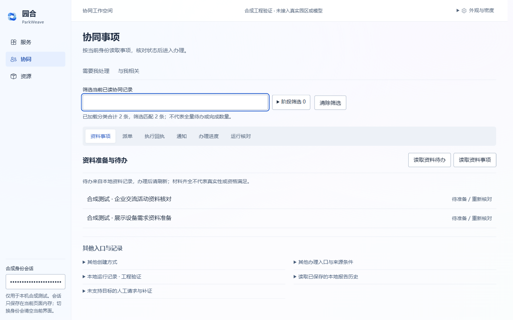
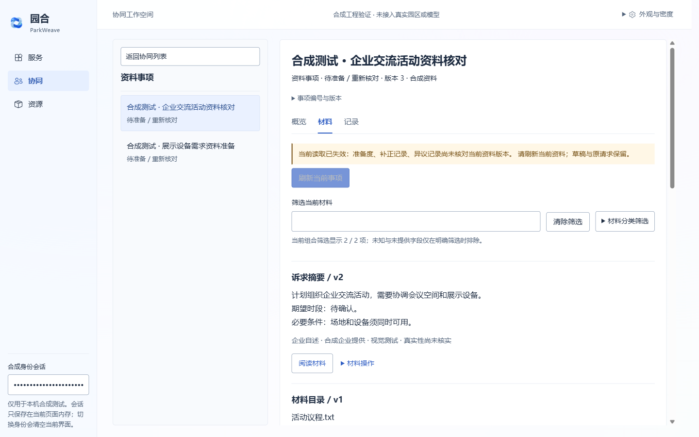

# 园合 ParkWeave 当前前端审阅入口

本页整理当前审阅版，供结合截图、代码和验证记录评审。四张主截图均为 **1440 × 900 的实际浏览器截图**。它们对应服务工作空间、资源工作空间、协同工作空间及事项详情。

## 项目是什么

园合 ParkWeave 面向园区企业服务办理和资源协同。企业表达目标，围绕同一事项准备资料、核对服务方案、选择资源时段、协同派单与回执，再由企业确认或局部修订。角色包括企业经办、园区专员、服务执行者和资源管理员；具体可做动作始终由现有授权和接口决定。当前资源管理员样例仅支持目录与来源只读。

当前是候选源码和合成测试工作台，不能据截图判断已经接入真实园区、实际预约或线下履约。

## 当前四张截图

### 1. 服务工作空间

目标输入和目录读取是主任务；继续已有资料事项为次级入口，低频入口集中到下方。

### 2. 资源工作空间

资源选择、约束、UTC 时段、数量和预检前置；右栏区分草稿与已选占位组合。示例为历史合成目录，不能据此判断当前资源可用。

### 3. 协同工作空间

按资料事项、派单、回执等分类展示原列表，各读取按钮保持原范围。这里的两条资料事项来自明确的测试 HTTP mock，并非真实用户记录。

### 4. 事项详情

左侧是精简的已加载事项列表，右侧为当前详情。此场景故意让二次读取校验失败，以验证失效提示、刷新入口和禁用守卫；不是业务成功页。

## 本阶段修改

- 保留浅蓝、白、淡蓝紫方向及现有品牌图标，降低渐变和边框的存在感。
- 界面统一为系统中文无衬线字体，建立标题、正文、元数据层级；普通按钮约 40px、输入框 42px。
- 移除多轮累积的局部视觉覆盖，建立共享样式与展示模块。
- 服务页突出一个目录读取动作，不将其改名为尚未发生的“提交申请”。
- 资源页把操作与关键约束放在前面，完整来源按需查看；预检、占位、确认保持不同阶段。
- 协同页由功能说明卡片墙改为分类列表工作台；未读、空结果、过滤无匹配、失败分别呈现。
- 详情采用独立主从结构，窄窗切换独立详情；材料原文、来源和操作分层，警告旁保留刷新入口。
- 保留原业务处理器、ID、表单归属、版本、权限和请求恢复机制，不新增虚构的业务计数或完成率。

## 代码与验证

- [共享样式](../../src/parkweave/workspace_design.css)
- [展示与交互模块](../../src/parkweave/workspace_design.js)
- [原工作台与业务处理器](../../src/parkweave/web.html)
- [详细验收记录、术语与前后对照](WorkspaceRebuild-20261104.md)
- [浏览器集成验证](../../tests/frontend_workspace_rebuild_browser.js)
- [预检状态验证](../../tests/frontend_resource_precheck_browser.js)

已检查四页在 1280×800、1440×900、1920×1080 下的布局；详情还覆盖窄窗。做过 125% 等效视口/DPR 模拟。六组既有 DOM 回归通过；相关 Python 检查 7 passed、6 skipped、3 subtests passed；JS 语法、Python 编译和声明版本的 wheel 构建通过。

数据库要求导致的六项跳过不计通过。真实四角色完整办理链路、Windows 原生 EXE、原生系统缩放和读屏器未完整验收。截图不能证明业务权限或真实履约已经通过。

## 希望审阅者进一步判断

1. 四个页面的第一视觉焦点和下一步是否足够明确，是否仍有松散、重复或不自然的功能分区。
2. 区块内部的中文、字段、长名称、状态、版本和来源排版是否易读；有哪些应删减、合并或重新安排的说明。
3. 字体、字号、字重、行高、留白、边框、按钮和颜色是否真正一致，是否还有明显模板感或粗糙细节。
4. 协同分类与详情主从结构是否自然，读取、筛选、返回与刷新是否清楚。
5. 哪些重要风险仍不够显著，哪些提示又过度重复；是否存在把草稿、目录读取、预检、占位或确认混淆的视觉表达。
6. 形成按优先级排列、可直接交给 Codex 实施的具体修改清单。请区分截图已观察到的问题、代码确认的问题和仍需实机验证的推测。

请勿为了填满页面增加虚构字段、指标或流程进度，也勿为了视觉简洁删除权限、失效、来源和模拟环境边界。没有查看代码或动态界面时，不要断言交互、动效和可访问性已经合格。
